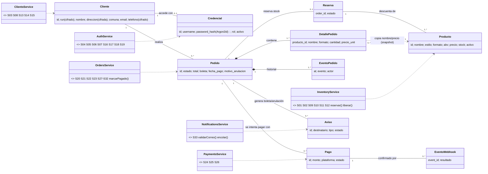
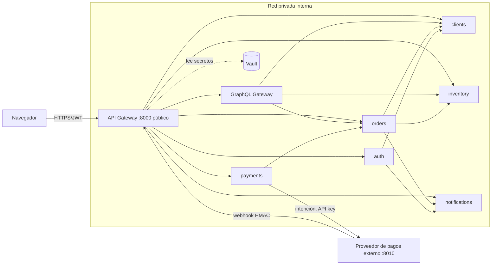
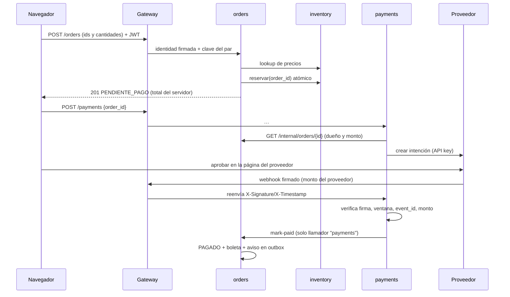
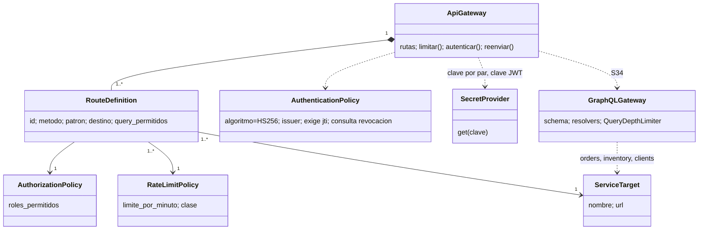

# Evaluación de la Unidad 2 — Backend seguro de Craft & Beer

**Caso:** Caso 10 - Cervecería artesanal “Craft & Beer” (botellas y growlers), ventas on-line.
**Integrantes:** Mauro Farias Gajardo
**Stack:** Python 3.12 + FastAPI, SQLAlchemy, Argon2id, JWT, HashiCorp Vault, GraphQL (Strawberry). BD: SQLite en pruebas locales, PostgreSQL en `docker-compose` (Oracle: ver brechas).

> Este informe describe lo **implementado**. Las matrices de rutas y permisos se generan desde el código (`scripts/gen_docs.py`). Las evidencias de la sección 10 son resultados de ejecución de `tests/test_e2e.py`.

## 0. Requisitos, pantallas y brechas declaradas

| Req. | Resumen | Cubierto por |
|---|---|---|
| RF1 / CU5 | Armar pedido con productos disponibles | S01, S02, S20 |
| RF2 | Preparar solo con pago confirmado | S24–S26 (solo `payments` confirma) |
| RF3 / CU7 | Anular compra con motivo | S23 |
| RF4 / CU6 | Ventas a clientes registrados, caja del cajero virtual | S20, S26, S32 |
| RF5, RF6, RF11 / CU3 | Registro (web o local) con validación real de correo | S04, S16 + `notifications` |
| RF7 / CU4 | Disponibilidad de productos | S09–S12 |
| RF8 | Boleta digital por correo | `orders` → `notifications` (outbox) |
| RF9 / CU8 | Reporte por período | S31 |
| RF10 / CU2–4 | Mantenedores producto, usuario, cliente | S09–S19 |
| RF12 / CU1 | Autenticación por perfil | S05–S07 |
| RF13 / CU9 | Orden de despacho en orden de llegada | S27–S30 |

Pantallas: P01 Catálogo · P02 Mi pedido · P03 Mis compras · P04 Mi cuenta · P05 Ingreso/Registro · P06 Productos · P07 Clientes · P08 Usuarios · P09 Anular compra · P10 Caja virtual · P11 Despacho · P12 Reporte.

**Brechas y decisiones que el equipo debe conocer (honestidad sobre el alcance):**

| Brecha | Estado |
|---|---|
| RNF3: Oracle y .NET/J2EE | Se usa Python/FastAPI (material de apoyo del curso). SQLAlchemy es portable: Oracle se activa con `DATABASE_URL=oracle+oracledb://…` + `pip install oracledb`. **No probado contra Oracle.** Confirmar con el docente. |
| RNF4: procedimientos almacenados | **No implementado.** El aviso por correo usa una tabla `outbox` con worker, no un procedimiento almacenado. |
| `docker-compose.yml` | Escrito pero **no ejecutado** en el entorno de desarrollo (sin Docker). La lógica se probó con procesos locales (`scripts/run_local.sh`). |
| TLS / mTLS | No configurado en la demo (HTTP). En producción: TLS en el borde y entre servicios. Mitigación actual: red privada + clave distinta por par de servicios + identidad firmada. |
| Radio de despacho (3 km) | Aproximado por comuna (tabla en `orders`); fuera de radio se marca y el chofer confirma costo. No hay geolocalización real. |
| Reembolsos | Se registra `REEMBOLSO_PENDIENTE`; el reembolso con el proveedor es manual. |
| Mayoría de edad | Supuesto de negocio (venta de alcohol): se exige ≥ 18 años al registrarse. |
| Frontend | Se verificó sintaxis y que el gateway lo sirve; **no se ejecutó en un navegador** automatizado. Probar los flujos a mano antes de entregar. |
| Analítica / gRPC | No aplican (ver ADR, sección 9). |

## 1. Servicios derivados del frontend

Convención: todas las rutas bajo `/api/v1`. Precios, totales, stock y estados **nunca** vienen del navegador: los calcula o valida el servidor.

| ID | Req. | Pantalla | Verbo y ruta externa | Propósito | Acceso | Destino interno | Datos |
|---|---|---|---|---|---|---|---|
| S01 | RF1, RF7 | P01 Catálogo | `GET /api/v1/products` | Listar productos activos | anónimo | inventory: /products | Público |
| S02 | RF1 | P01 Catálogo | `GET /api/v1/products/{id}` | Detalle de un producto | anónimo | inventory: /products/{id} | Público |
| S03 | RF5 | P05 Registro | `GET /api/v1/geo/comunas` | Comunas/regiones válidas | anónimo | clients: /geo/comunas | Público |
| S04 | RF5, RF6, RF11 | P05 Registro | `POST /api/v1/auth/register` | Registro de cliente con validación de correo | anónimo | auth: /auth/register | Personal (RUN, dirección, teléfono) + credencial |
| S05 | RF12 / CU1 | P05 Ingreso | `POST /api/v1/auth/login` | Autenticación; entrega JWT de 15 min | anónimo | auth: /auth/login | Credencial |
| S06 | RF12 | Todas · Cerrar sesión | `POST /api/v1/auth/logout` | Revocar el token | cualquier sesión válida | gateway (revoca jti) | — |
| S07 | RNF7 | P04 Mi cuenta | `POST /api/v1/auth/password` | Cambiar contraseña | cualquier sesión válida | auth: /auth/password | Credencial |
| S08 | RF5 | P04 Mi cuenta | `GET /api/v1/me` | Perfil propio | Cliente | clients: /clients/me | Personal |
| S09 | RF7, RF10 / CU4 | P06 Productos | `GET /api/v1/admin/products` | Catálogo completo con stock | Administrador, Dueño | inventory: /admin/products | Interno de negocio |
| S10 | RF10 / CU4 | P06 Productos | `POST /api/v1/products` | Crear producto | Administrador, Dueño | inventory: /products | Interno de negocio |
| S11 | RF7, RF10 / CU4 | P06 Productos | `PUT /api/v1/products/{id}` | Reemplazar precio/stock/estado | Administrador, Dueño | inventory: /products/{id} | Interno de negocio |
| S12 | RF10 / CU4 | P06 Productos | `DELETE /api/v1/products/{id}` | Descontinuar (baja lógica) | Administrador | inventory: /products/{id} | Interno de negocio |
| S13 | RF10 / CU3 | P07 Clientes | `GET /api/v1/clients` | Listar clientes | Administrador | clients: /clients | Personal |
| S14 | RF10 / CU3 | P07 Clientes | `GET /api/v1/clients/{id}` | Ver un cliente | Administrador | clients: /clients/{id} | Personal |
| S15 | RF10 / CU3 | P07 Clientes (API) | `PUT /api/v1/clients/{id}` | Actualizar datos de contacto | Administrador | clients: /clients/{id} | Personal |
| S16 | RF6 / CU3 | P07 Clientes | `POST /api/v1/admin/clients` | Registro desde el local | Administrador | auth: /auth/register-by-admin | Personal + credencial |
| S17 | RF10 / CU2 | P08 Usuarios | `GET /api/v1/users` | Listar usuarios internos | Administrador | auth: /users | Interno |
| S18 | RF10 / CU2 | P08 Usuarios | `POST /api/v1/users` | Crear usuario interno | Administrador | auth: /users | Credencial |
| S19 | RF10 / CU2 | P08 Usuarios (API) | `PUT /api/v1/users/{id}` | Cambiar rol/estado/clave | Administrador | auth: /users/{id} | Credencial |
| S20 | RF1 / CU5 | P02 Mi pedido | `POST /api/v1/orders` | Crear pedido (precio y stock decididos en servidor) | Cliente | orders: /orders | Personal (dirección) |
| S21 | RF3, RF4 | P03, P09 | `GET /api/v1/orders` | Listar pedidos (propios o según rol) | Administrador, Cajero virtual, Cliente, Dueño | orders: /orders | Personal según rol |
| S22 | RF3, RF4 | P03 | `GET /api/v1/orders/{id}` | Ver un pedido | Administrador, Cajero virtual, Cliente, Dueño | orders: /orders/{id} | Personal según rol |
| S23 | RF3 / CU7 | P03, P09 | `POST /api/v1/orders/{id}/cancel` | Anular con motivo; devuelve stock | Administrador, Cliente | orders: /orders/{id}/cancel | Interno |
| S24 | RF2, RF4 | P02 Mi pedido | `POST /api/v1/payments` | Iniciar pago con proveedor externo | Cliente | payments: /payments | Interno |
| S25 | RF2 | P02 | `GET /api/v1/payments/{id}` | Consultar estado de un pago propio | Cliente | payments: /payments/{id} | Interno |
| S26 | RF2, RF4 | (proveedor externo) | `POST /api/v1/webhooks/provider` | Webhook firmado: confirma o rechaza el pago | anónimo + firma HMAC | payments: /webhooks/provider | Interno |
| S27 | RF13 / CU9 | P11 Despacho | `GET /api/v1/dispatch/orders` | Cola de despacho en orden de llegada | Encargado de despacho | orders: /dispatch/orders | Personal (dirección) |
| S28 | RF13 | P11 Despacho | `POST /api/v1/dispatch/orders/{id}/start` | PAGADO → EN_DESPACHO | Encargado de despacho | orders: /dispatch/orders/{id}/start | Interno |
| S29 | RF13 | P11 Despacho | `POST /api/v1/dispatch/orders/{id}/deliver` | EN_DESPACHO → ENTREGADO | Encargado de despacho | orders: /dispatch/orders/{id}/deliver | Interno |
| S30 | RF13 / CU9 | P11 Despacho | `GET /api/v1/dispatch/orders/{id}/print` | Orden imprimible | Encargado de despacho | orders: /dispatch/orders/{id}/print | Personal (dirección) |
| S31 | RF9 / CU8 | P12 Reporte | `GET /api/v1/reports/sales` | Ventas por período | Administrador, Dueño | orders: /reports/sales | Interno agregado |
| S32 | RF4, RF8 / CU6 | P10 Caja virtual | `GET /api/v1/cashier/sales` | Ventas y boletas de la caja virtual | Administrador, Cajero virtual | orders: /cashier/sales | Interno |
| S33 | RF8, RNF4 | (evidencia) | `GET /api/v1/admin/outbox` | Avisos emitidos por el outbox (sin cuerpo) | Administrador | notifications: /admin/outbox | Interno |
| S34 | RF3, RF4 | P03 Mis compras | `POST /api/v1/graphql` | Agregación GraphQL orders+inventory+clients | cualquier sesión válida | graphql: /graphql | Según campo |

**Ejemplos de contrato (datos ficticios)**

`POST /api/v1/orders` — entrada (el navegador solo envía ids y cantidades; el campo `total` que agregue se ignora):
```json
{"items":[{"product_id":"P2","cantidad":1},{"product_id":"P3","cantidad":2}],"plataforma_pago":"Servipag"}
```
Salida `201`: `{"id":12,"estado":"PENDIENTE_PAGO","total":11470,"items":[{"producto_id":"P2","nombre":"Andina IPA","cantidad":1,"precio_unit":3490,"subtotal":3490}],"direccion_despacho":"Los Aromos 234, Maipú","fuera_de_radio":false}`
Errores: `409` stock insuficiente (`{"mensaje":"Stock insuficiente","productos":["P5"]}`), `422` validación, `503` inventario no disponible (no se crea el pedido).

`GET /api/v1/products?available=true` → `200 [{"id":"P1","nombre":"Chasqui Golden Ale","estilo":"Golden Ale","formato":"Botella 330ml","abv":4.8,"precio":2990,"disponible":true,"ultimas_unidades":null}]`. No expone stock exacto salvo “últimas N unidades” (≤10).

`POST /api/v1/webhooks/provider` (proveedor) — cabeceras `X-Timestamp`, `X-Signature`; cuerpo `{"event_id":"a1b2c3d4e5","payment_id":"…","status":"APPROVED","amount":11470}` → `200 {"ok":true,"estado":"CONFIRMADO"}`; repetido → `200 {"duplicate":true}`; firma mala → `401`; monto distinto → `422`.

## 2. Clases y cardinalidades


_Notación:_ línea sólida = asociación; rombo lleno = composición; punteada = dependencia de uso (no relación entre registros). `<<service>>` = servicio público vía gateway; los `/internal/*` no se publican.

| Origen → destino | Mult. | Regla de negocio que la origina |
|---|---|---|
| Cliente → Credencial | 1 — 0..1 | Un cliente registrado tiene una credencial; el personal tiene credencial sin cliente |
| Cliente → Pedido | 1 — 0..* | RF4: solo clientes registrados compran; puede no haber comprado aún |
| Pedido → DetallePedido | 1 — 1..* | Un pedido (aun pendiente) siempre tiene ≥ 1 ítem; no existe carrito persistido: el carrito vive en el navegador y se convierte en pedido al confirmar |
| Pedido → Pago | 1 — 0..* | Se puede reintentar tras un rechazo; solo un pago PENDIENTE a la vez |
| Pago → EventoWebhook | 1 — 0..* | El proveedor puede reenviar; `event_id` único evita doble proceso |
| Reserva → Producto | 1 — 1..* | Una reserva descuenta stock de uno o más productos |
| DetallePedido ⇢ Producto | snapshot | Si el producto cambia de precio o se descontinúa, el historial no cambia |

**Modelo interno vs DTO:** el catálogo público omite `stock` y `activo`; el dueño y el cajero no reciben dirección; el cliente nunca recibe `cliente_id` ajeno ni `reembolso_pendiente`; `password_hash` no sale de `auth`.

## 3. Sistemas e integraciones

| Sistema | Responsabilidad | Datos bajo su autoridad | Servicios | Depende de | Credencial / identidad | Ante fallos |
|---|---|---|---|---|---|---|
| inventory | Catálogo, precios, stock, reservas atómicas e idempotentes | products, reservations | S01 S02 S09–S12 | — | recibe `from-gateway`, `from-orders`, `from-graphql` | Sin reserva → orders responde 503 y no crea pedido |
| orders | Ciclo de vida del pedido, anulación, despacho, reportes | orders, items, eventos | S20–S23 S27–S32 | inventory, clients, notifications | `to-inventory`, `to-clients`, `to-notifications`; acepta `from-payments` para `mark-paid` | Anular libera stock **antes** de cambiar estado; si falla, el pedido no cambia y se puede reintentar |
| clients | Perfil del cliente (RUN, dirección y teléfono cifrados) | clients | S03 S08 S13–S15 | — | `from-gateway`, `from-auth`, `from-orders`, `from-graphql` | auth compensa borrando el perfil si no crea la credencial |
| payments | Iniciar pago; **única** autoridad que confirma | payments, webhook_events | S24–S26 | orders, proveedor | `to-orders`, `provider-api-key`, `webhook-secret` | Si orders no responde se descarta el evento para que el proveedor reintente; pago tardío → `REEMBOLSO_PENDIENTE` |
| auth *(complementario)* | Credenciales, JWT, revocación | credentials, revoked_tokens | S04–S07 S16–S19 | clients, notifications | `to-clients`, `to-notifications` | Sin auth el gateway **falla cerrado** (503) |
| notifications *(complementario)* | Validar correo y outbox de avisos (boletas) | outbox | S33 | adaptador de correo | `from-auth`, `from-orders` | Aviso queda PENDING y se reintenta (hasta 5) |
| graphql *(agregación)* | Componer orders + inventory + clients | ninguno | S34 | orders, inventory, clients | identidad reenviada | Error parcial: pedido sí, campos de producto null |



**Secuencia: compra y pago**


## 4. Stakeholders y permisos

| Stakeholder | Interés | Rol | Uso de información |
|---|---|---|---|
| Cliente | Comprar y seguir su pedido | cliente | Solo sus datos y pedidos |
| Administrador | Operar maestros y anular | administrador | Datos de clientes y pedidos |
| Cajero virtual | Ventas y boletas de la web | cajero_virtual | Ventas sin dirección |
| Encargado de despacho | Preparar y entregar | despacho | Dirección y nombre del pedido a despachar |
| Dueño | Resultados y catálogo | dueno | Reportes agregados; edita productos |
| Proveedor de pagos | Avisar resultado | identidad técnica (HMAC) | Solo `payment_id`, monto, estado |
| Servicios internos | Colaborar | identidades técnicas por par | Mínimo por operación |
| Auditoría / supervisión | Revisar | **sin permisos operativos** | Recibe los avisos del outbox vía administrador (S33) y logs con correlation-id |

| ID | Ruta | GET | POST | PUT | DELETE | Quién | Condición / dónde se verifica |
|---|---|---|---|---|---|---|---|
| S01 | `/products` | permitido | — | — | — | anónimo | rol exigido; se verifica en gateway y de nuevo en el servicio destino |
| S02 | `/products/{id}` | permitido | — | — | — | anónimo | rol exigido; se verifica en gateway y de nuevo en el servicio destino |
| S03 | `/geo/comunas` | permitido | — | — | — | anónimo | rol exigido; se verifica en gateway y de nuevo en el servicio destino |
| S04 | `/auth/register` | — | permitido | — | — | anónimo | rol exigido; se verifica en gateway y de nuevo en el servicio destino |
| S05 | `/auth/login` | — | permitido | — | — | anónimo | rol exigido; se verifica en gateway y de nuevo en el servicio destino |
| S06 | `/auth/logout` | — | permitido | — | — | cualquier sesión válida | rol exigido; se verifica en gateway y de nuevo en el servicio destino |
| S07 | `/auth/password` | — | permitido | — | — | cualquier sesión válida | rol exigido; se verifica en gateway y de nuevo en el servicio destino |
| S08 | `/me` | permitido | — | — | — | Cliente | solo su propio perfil (client_id del JWT) |
| S09 | `/admin/products` | permitido | — | — | — | Administrador, Dueño | rol exigido; se verifica en gateway y de nuevo en el servicio destino |
| S10 | `/products` | — | permitido | — | — | Administrador, Dueño | rol exigido; se verifica en gateway y de nuevo en el servicio destino |
| S11 | `/products/{id}` | — | — | permitido | — | Administrador, Dueño | rol exigido; se verifica en gateway y de nuevo en el servicio destino |
| S12 | `/products/{id}` | — | — | — | permitido | Administrador | solo administrador (el dueño edita pero no descontinúa) |
| S13 | `/clients` | permitido | — | — | — | Administrador | rol exigido; se verifica en gateway y de nuevo en el servicio destino |
| S14 | `/clients/{id}` | permitido | — | — | — | Administrador | rol exigido; se verifica en gateway y de nuevo en el servicio destino |
| S15 | `/clients/{id}` | — | — | permitido | — | Administrador | rol exigido; se verifica en gateway y de nuevo en el servicio destino |
| S16 | `/admin/clients` | — | permitido | — | — | Administrador | rol exigido; se verifica en gateway y de nuevo en el servicio destino |
| S17 | `/users` | permitido | — | — | — | Administrador | rol exigido; se verifica en gateway y de nuevo en el servicio destino |
| S18 | `/users` | — | permitido | — | — | Administrador | rol exigido; se verifica en gateway y de nuevo en el servicio destino |
| S19 | `/users/{id}` | — | — | permitido | — | Administrador | rol exigido; se verifica en gateway y de nuevo en el servicio destino |
| S20 | `/orders` | — | permitido | — | — | Cliente | rol exigido; se verifica en gateway y de nuevo en el servicio destino |
| S21 | `/orders` | permitido | — | — | — | Administrador, Cajero virtual, Cliente, Dueño | cliente: solo los suyos; staff: todos sin dirección salvo administrador |
| S22 | `/orders/{id}` | permitido | — | — | — | Administrador, Cajero virtual, Cliente, Dueño | cliente: solo si le pertenece (404 si no); lo verifica orders |
| S23 | `/orders/{id}/cancel` | — | permitido | — | — | Administrador, Cliente | cliente dueño en PENDIENTE/PAGADO; administrador también EN_DESPACHO; lo verifica orders |
| S24 | `/payments` | — | permitido | — | — | Cliente | solo pedidos propios y PENDIENTE_PAGO; monto lo toma payments desde orders |
| S25 | `/payments/{id}` | permitido | — | — | — | Cliente | solo pagos propios; lo verifica payments |
| S26 | `/webhooks/provider` | — | permitido | — | — | anónimo + firma HMAC | firma HMAC + ventana 5 min + event_id único + monto igual al registrado; lo verifica payments |
| S27 | `/dispatch/orders` | permitido | — | — | — | Encargado de despacho | rol exigido; se verifica en gateway y de nuevo en el servicio destino |
| S28 | `/dispatch/orders/{id}/start` | — | permitido | — | — | Encargado de despacho | rol exigido; se verifica en gateway y de nuevo en el servicio destino |
| S29 | `/dispatch/orders/{id}/deliver` | — | permitido | — | — | Encargado de despacho | rol exigido; se verifica en gateway y de nuevo en el servicio destino |
| S30 | `/dispatch/orders/{id}/print` | permitido | — | — | — | Encargado de despacho | rol exigido; se verifica en gateway y de nuevo en el servicio destino |
| S31 | `/reports/sales` | permitido | — | — | — | Administrador, Dueño | rol exigido; se verifica en gateway y de nuevo en el servicio destino |
| S32 | `/cashier/sales` | permitido | — | — | — | Administrador, Cajero virtual | rol exigido; se verifica en gateway y de nuevo en el servicio destino |
| S33 | `/admin/outbox` | permitido | — | — | — | Administrador | rol exigido; se verifica en gateway y de nuevo en el servicio destino |
| S34 | `/graphql` | — | permitido | — | — | cualquier sesión válida | identidad se reenvía a orders; campo `cliente` solo administrador/cajero |

Un verbo permitido no autoriza todas las rutas: la tabla es por ruta. Ocultar un botón no otorga ni quita permisos; todo se verifica en servidor. La anulación **no borra**: cambia a `ANULADO` y deja evento, motivo y quién anuló.

## 5. API Gateway y políticas

Se usa **un solo gateway público** (la separación se logra con la tabla de rutas y políticas). Justificación: un único punto de entrada simplifica límites, auditoría y CORS; varios gateways se justificarían por equipos o dominios distintos, que aquí no existen. El GraphQL Gateway es un servicio **privado** detrás de él.



**Fronteras de confianza.** (1) Internet → gateway: nada es confiable; se exige JWT, rol y se limita tasa/tamaño. (2) Gateway → servicios: el gateway **descarta** `X-Identity` y `X-Service-*` del navegador y construye sus propias cabeceras; envía una identidad firmada de 30 s. (3) Cada servicio vuelve a comprobar llamador y rol (no confía en que el gateway ya lo hizo) y aplica propiedad y reglas de negocio.

**Solicitud autorizada:** `GET /orders/12` de su dueño → gateway valida JWT, revocación y rol → `orders` verifica llamador, firma de identidad y `client_id` = dueño → 200.
**Solicitud denegada:** otro cliente pide `/orders/12` → mismo recorrido, pero `orders` responde **404** sin datos (no revela si existe).

El gateway devuelve 401 (sin/mal token), 403 (rol), 404 (ruta inexistente), 405, 413 (cuerpo > 64 KB), 429, 502/504 (servicio caído/lento, plazo de 8 s), 503 (auth no disponible: falla cerrado). Logs con correlation-id, sin tokens ni claves.

## 6. Rutas y secretos de integración

La matriz de rutas externas es la tabla de la sección 1 (cada fila vincula ID, verbo, ruta, acceso, destino). Lo que no está en la lista responde 404; las rutas `/internal/*` nunca se publican.

| Referencia | Tipo | Emisor | Consumidor | Finalidad | Ubicación | Rotación / revocación |
|---|---|---|---|---|---|---|
| `jwt-signing-key` | Clave HMAC | gen_secrets / admin | auth, gateway | Firmar/validar JWT de usuario | Vault `secret/cb/auth`, `…/gateway` | Cambiar en Vault; los tokens vigentes (≤15 min) dejan de valer |
| `identity-key` | Clave HMAC | admin | gateway (firma); servicios (verifican) | Identidad reenviada de 30 s | Vault por servicio | Rotar en Vault (caché ≤ 60 s) |
| `to-X` / `from-Y` | Credencial de servicio **por par** | admin | llamador / destino | Autenticar llamador interno | Vault (solo la ruta de cada servicio) | Rotar el par; un par filtrado solo expone ese par |
| `data-enc-key` (clients, orders) | Clave Fernet | admin | clients / orders | Cifrar RUN, dirección, teléfono | Vault | Rotación con re-cifrado (no automatizada) |
| `webhook-secret` | Secreto compartido | proveedor | payments, proveedor | Firma HMAC del webhook | Vault | Rotar con el proveedor |
| `provider-api-key` | API key | proveedor | payments | Crear intenciones de pago | Vault | Revocar en el proveedor |
| Credencial de BD | Usuario/clave | admin | **cada servicio** su BD | Acceso a datos | `.env` en compose (Vault dynamic secrets en producción) | Rotar en BD y `.env` |

En Vault cada servicio tiene su **política y token propios** que solo leen `secret/data/cb/<servicio>` (`scripts/vault_init.sh`). El navegador nunca recibe secretos; el JWT del usuario es de vida corta y revocable. Si Vault no responde, los servicios siguen con la copia en caché y, sin copia, **fallan cerrado**. Si una clave se filtra: rotarla en Vault y reiniciar/esperar la caché; para JWT, cambiar `jwt-signing-key` invalida todas las sesiones.

**GraphQL:** `POST /api/v1/graphql` (cualquier sesión). Operaciones: `Query.resumenPedido(id)` y `Query.misPedidos(limit, offset)`. Resolvers: `orders` (con la identidad reenviada), `inventory` (DataLoader en lote), `clients` (solo si rol administrador/cajero). Campo `cliente`: solo administrador y cajero virtual. **gRPC:** no aplica.

## 7. Datos sensibles y secretos del cliente

| Dato | Finalidad | Clasificación | Custodio | Roles autorizados | En frontend | Protección | Retención |
|---|---|---|---|---|---|---|---|
| Catálogo (nombre, estilo, precio) | Vender | Público | inventory | Todos | Sí | — | Permanente |
| Stock exacto | Gestión | Interno | inventory | admin, dueño | Solo en mantenedor | Rol | Permanente |
| RUN | Identificar cliente | Personal restringido | clients | Cliente (propio), administrador | Solo en “Mi cuenta” y mantenedor | Cifrado Fernet + índice ciego HMAC para unicidad | Mientras exista la cuenta |
| Dirección, teléfono | Despacho/contacto | Personal restringido | clients / orders (snapshot) | Dueño del dato, despacho (dirección), admin | Sí, solo al titular | Cifrado en reposo; dirección no sale en catálogo, reportes ni GraphQL | Con el pedido |
| Correo | Login y avisos | Personal | clients/auth | Titular, admin | Sí | Validado vía adaptador | Mientras exista la cuenta |
| Contraseña | Autenticar | **Credencial** | auth | Nadie la lee | Solo al escribirla | Argon2id con sal; nunca se devuelve ni se registra; política ≥10, mayúsculas y dígito; bloqueo tras 5 fallos | — |
| JWT | Sesión | Credencial temporal | navegador (sessionStorage) | Titular | Sí | 15 min, firmado, revocable (logout) | Expira |
| Claves del proveedor | Integración | **Secreto de integración** | Vault / payments | Solo payments | **Nunca** | Vault, mínimo alcance | Rotación |

**Decisión sobre secretos del cliente: NO se custodian.** No se guardan tarjetas, claves bancarias ni tokens del cliente: el pago ocurre en el proveedor externo y el sistema solo recibe un aviso firmado con estado y monto. Lo restringido (RUN, dirección) es dato personal, no clave.

**Recorrido de un dato (dirección):** el cliente la escribe (P05/P02) → TLS al gateway → validada por `clients`/`orders` → se cifra y guarda → se descifra solo para el titular, el repartidor del pedido y el administrador → no entra a logs → se conserva con el pedido por trazabilidad de la venta; se elimina junto con el cliente si el negocio lo autoriza (no hay borrado automático implementado).

## 8. Separación privada y agregación GraphQL

| Servicio | Naturaleza | Datos propios | Contrato | Justificación de separación |
|---|---|---|---|---|
| inventory | Transaccional | productos, reservas | REST | Ciclo de cambio distinto (catálogo vs. pedidos); la reserva atómica necesita ser dueña del stock |
| orders | Transaccional | pedidos | REST | Reglas de estado y propiedad |
| clients | Transaccional | perfil cifrado | REST | Datos personales aislados con su propia clave |
| payments | Transaccional | pagos, eventos | REST + webhook | Aísla credenciales del proveedor y la idempotencia |
| auth | Transaccional | credenciales | REST | Las credenciales no comparten BD con datos de negocio |
| notifications | Asíncrono (outbox) | avisos | REST interno | Entrega con reintentos sin bloquear la venta |
| graphql | Agregación | ninguno | GraphQL | Compone sin acceder a BD ajenas |
| analítica / alta demanda | — | — | — | No aplica (ADR) |

```graphql
type Query {
  resumenPedido(id: Int!): PedidoResumen!
  misPedidos(limit: Int! = 10, offset: Int! = 0): [PedidoResumen!]!
}
type PedidoResumen { id: Int! estado: String! total: Int! boleta: String fecha: String! plataformaPago: String
                     items: [ItemPedido!]!  cliente: ClienteResumen }   # cliente: solo administrador/cajero
type ItemPedido { productoId: String! nombre: String! formato: String! cantidad: Int! precioUnit: Int! subtotal: Int!
                  estilo: String  abv: Float  disponibleAhora: Boolean }  # estos 3 vienen de inventory (anulables)
type ClienteResumen { nombre: String! comuna: String! }
```
**Consulta de prueba:** `{ resumenPedido(id: 12) { estado total items { nombre cantidad estilo disponibleAhora } } }`
**Respuesta esperada:** `{"data":{"resumenPedido":{"estado":"PAGADO","total":11470,"items":[{"nombre":"Andina IPA","cantidad":1,"estilo":"India Pale Ale","disponibleAhora":true}]}}}`

Controles: identidad verificada y **reenviada** a orders (que sigue siendo la autoridad de propiedad: un cliente pidiendo un pedido ajeno recibe error sin datos); autorización por campo (`cliente`); `misPedidos` limitado a 50; profundidad máxima 5; plazo de 3 s por llamada; batching de productos con DataLoader (una consulta a inventory para todos los ítems); si inventory cae, los campos de producto vienen `null` con error y el pedido se entrega. **Pantalla P03 “Mis compras” usa esta agregación a través del gateway**; el navegador no puede llamar a los servicios privados (puertos no publicados; probado: acceso directo → 403).

## 9. ADR — analítica y gRPC

**Contexto.** Cervecería local con ventas limitadas (RF del caso). Carga proyectada (supuesto, no medición): decenas de pedidos por día, picos de pocos por minuto; reporte de ventas por período sobre miles de filas; mensajes de < 5 KB; sin necesidad de streaming ni baja latencia entre servicios.
**Alternativas.** (a) Servicio de analítica con almacén propio; (b) gRPC entre `orders` e `inventory`; (c) REST + consulta agregada en `orders`.
**Decisión.** (c). El reporte (S31) se resuelve con una consulta sobre `orders` (índices por estado y fecha de pago). REST/JSON basta para la comunicación interna.
**Consecuencias.** Menor complejidad y superficie de ataque. Si el negocio crece (muchos locales, reportes históricos pesados, eventos de despacho en tiempo real) se revisaría: analítica separada alimentada desde el outbox/eventos y streaming de estado de despacho por gRPC. **No se afirma ninguna mejora de rendimiento: no se realizó prueba de carga.** Pendiente para el equipo: ejecutar una carga reproducible (p. ej. `locust`) sobre S20/S21/S31 y registrar p95, throughput y errores para respaldar esta decisión.

## 10. Backend completo y evidencias

**Arranque (sin Docker):** `pip install -r requirements.txt && scripts/run_local.sh --fresh` → http://127.0.0.1:8000 (el gateway sirve el frontend). Detener: `scripts/stop_local.sh`. **Con Docker:** `scripts/prepare_compose.sh && docker compose up --build` (no probado, ver brechas). **Pruebas:** `pytest -v tests` con el sistema arriba. Cuentas de demostración del personal: `admin`, `cajero`, `despacho`, `dueno` (contraseñas en `.secrets/seed.env`, generadas localmente; **no versionadas**). Salud: `GET /health` en cada servicio.

**Resultado medido:** `40 passed` en `tests/test_e2e.py` (ejecución contra procesos reales: gateway, 6 servicios, GraphQL y proveedor sandbox, con persistencia SQLite).

| Req. | Pantalla | Servicio | Prueba (nombre en `tests/test_e2e.py`) | Resultado |
|---|---|---|---|---|
| RF1 | P01 | S01 | `test_v1_catalogo_anonimo_sin_stock_exacto` | Pasa |
| RF12 | todas | S05, S06 | `test_v2_sin_sesion_401`, `test_v2_token_falso_o_manipulado_401`, `test_logout_revoca_token` | Pasa |
| RF12 | P06–P09 | S09–S19 | `test_v3_cliente_no_administra`, `test_v3_roles_staff_cruzados`, `test_v3_cabecera_identidad_falsa_se_ignora` | Pasa |
| RNF7 | P05 | S04, S05 | `test_login_mensaje_uniforme_y_bloqueo`, `test_datos_personales_cifrados_en_reposo` | Pasa |
| RF5, RF6, RF11 | P05, P07 | S04, S16 | `test_registro_valida_run_edad_correo_y_duplicados`, `test_admin_registra_cliente_y_lista` | Pasa |
| acceso directo | — | todos | `test_v5_acceso_directo_sin_credencial_403`, `test_v5_credencial_de_otro_par_no_sirve_para_mark_paid`, `test_v5_rutas_internas_no_se_publican` | Pasa |
| RF1, RF3 | P02, P03 | S20–S23 | `test_pedido_precio_lo_decide_el_servidor_y_propiedad` (pedido ajeno → 404), `test_validaciones_de_pedido`, `test_pedido_con_producto_sin_stock` | Pasa |
| RF3 | P03, P09 | S23 | `test_stock_reserva_sobreventa_y_recuperacion`, `test_admin_cancela_en_despacho_y_devuelve_stock` | Pasa |
| RF2, RF4, RF8 | P02, P10 | S24–S26 | `test_v6_pago_firma_monto_duplicado_y_boleta` (firma falsa, timestamp viejo, monto alterado, evento duplicado, boleta única, pago de pedido ajeno) | Pasa |
| RF2 | P02 | S26 | `test_pago_rechazado_y_pago_tardio` (queda `REEMBOLSO_PENDIENTE`) | Pasa |
| RF13, RF9 | P11, P12 | S27–S31 | `test_despacho_flujo_y_reporte` | Pasa |
| RF10 | P06, P08 | S09–S12, S17–S19 | `test_mantenedor_productos_soft_delete_conserva_historial`, `test_mantenedor_usuarios` | Pasa |
| agregación | P03 | S34 | `test_v8_graphql_agrega_orders_e_inventory_y_respeta_propiedad`, `test_v8_graphql_limite_de_profundidad` | Pasa |
| robustez | — | gateway | `test_gateway_ruta_inexistente_metodo_y_tamano`, `test_correlation_id_y_logs_sin_secretos`, `test_rate_limit_en_rutas_de_autenticacion` | Pasa |

**No cubierto por pruebas automatizadas (declarado):** Vault real y compose (no ejecutados), caída de dependencias (inventory/orders/auth apagados), expiración automática de pedidos impagos (hilo implementado, sin prueba), TLS, prueba de carga, y los flujos del frontend en navegador.
